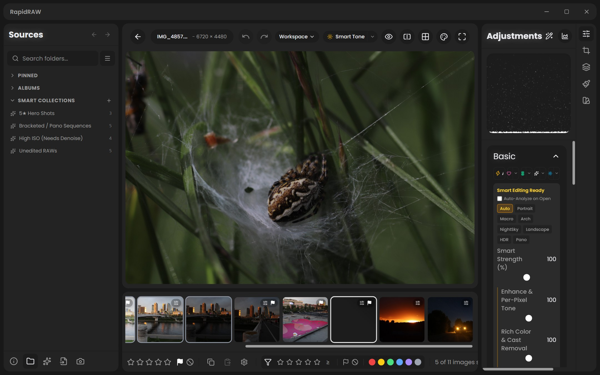
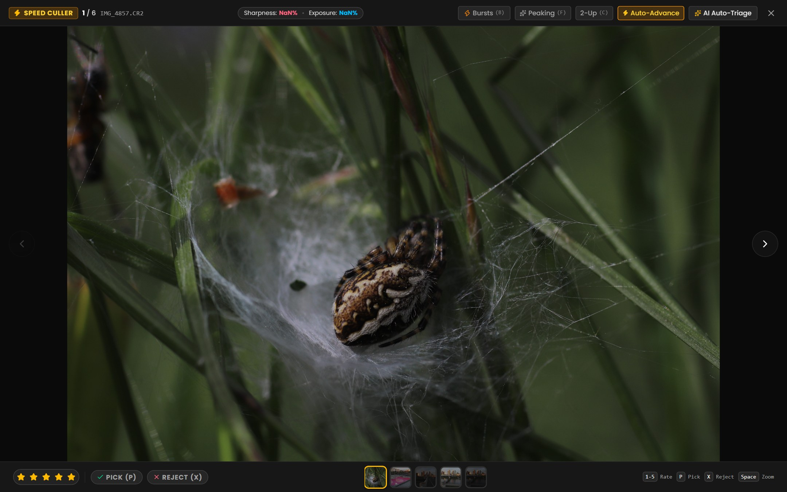
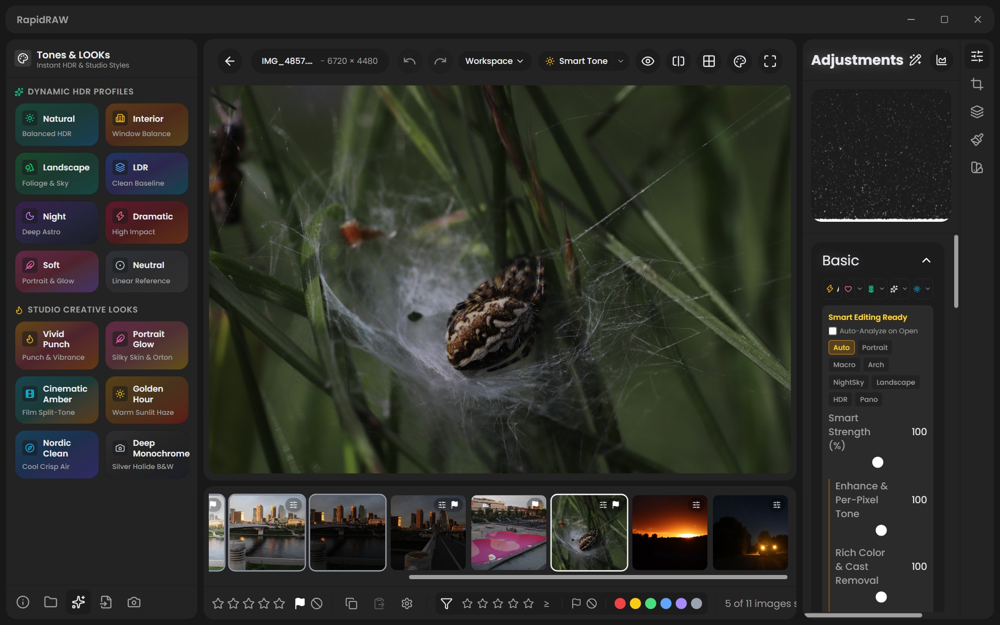
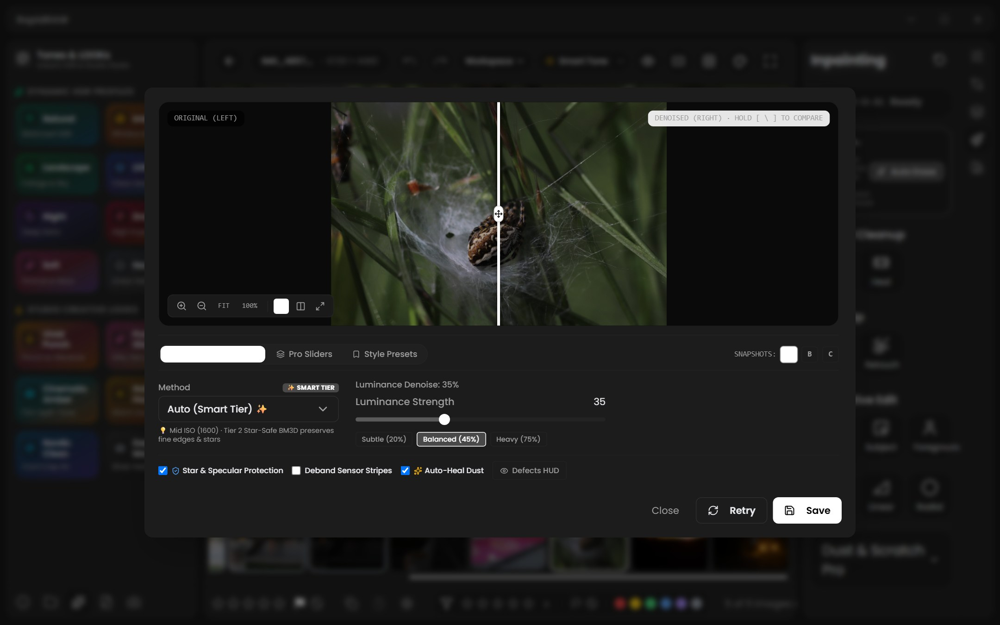
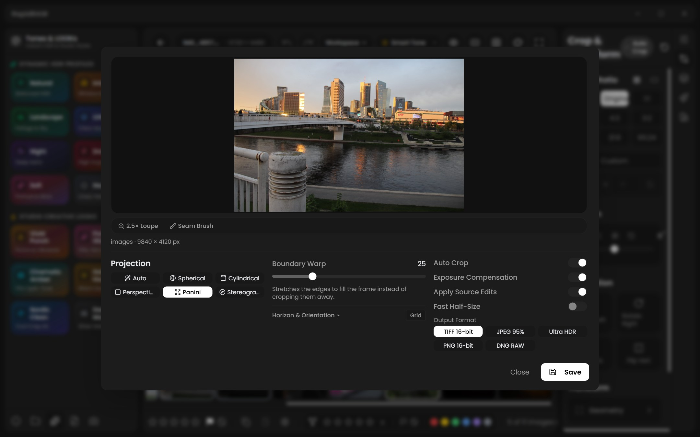

# RapidRAW v1.7.1.3 — Complete Visual Feature Guide & Upgrade Overview

> **Non-destructive, GPU-accelerated RAW photo editor built on Rust, `wgpu`, and React.**
> This guide documents **all core RapidRAW capabilities** alongside **every new feature, workflow upgrade, and reliability fix added in `v1.7.1.3`** compared to the official **`v1.7.1`** release — with real screenshots and clear end-user benefits.

---

## Documentation Chapters

| Chapter | What It Covers | Key Highlights |
| --- | --- | --- |
| **[01. Library, Catalog & AI Culling](guide/01-library-catalog-culling.md)** | Library grid, folder tree, albums, Immich, filtering, smart collections, AI culling | **NEW** SQLite WAL Catalog & Smart Collections, Auto-Paused CLIP Search, MediaPipe EAR Speed Culler, Hero Curator, Continue Session |
| **[02. RAW Editor, Color Science & Pro Scopes](guide/02-raw-editor-color-science.md)** | Tone mappers, exposure/contrast, OKLab color grading, curves, scopes, compare modes | **NEW** Lights Sub-Pipeline, Supercontrast Curve, Reference Presets Ribbon, Tones Studio Panel, Smart Auto-Edit + Local Adaptive Priors, Split Compare & 4-Way Matrix |
| **[03. AI Denoise, Masking, Portrait Pro & Dust Repair](guide/03-ai-denoise-retouch-portrait.md)** | AI masks, Match Brush, Clone/Heal/Liquify/Retouch, RapidRes, Denoise, Bokeh | **NEW** Interactive Dust & Blemish Spot Editor, AI Denoise Modal (Smart Auto-Tier, Minimap, ROI Lock, X-Trans GAT), Portrait Pro Suite, Bokeh Fusion Modal, Mask Refinement |
| **[04. Computational Merges, Astro & Negative Lab](guide/04-computational-merges-astro.md)** | Panorama, HDR, Focus Stacking, Drizzle, Astro Stacking, Color Matcher, Film Negatives | **UPGRADED** Unified Merge Modal (Panini/Stereographic, Fast Draft, 60 FPS brushes, DepthMap Focus Stack), **NEW** Drizzle Kappa-Sigma, Astro Homography, Color Matcher (SOT), Film Base Lock |
| **[05. Export, Stock Prep, Client Delivery & Round-Trip](guide/05-export-delivery-integrations.md)** | Export presets, ICC/HDR export, Collage, Tethering, Edit In, Immich | **NEW** Client Delivery Modal, Advanced Batch Export, Stock Prep & Compliance Inspector, `lrtemplate` Converter, Typography Watermarks, CLI Launch |
| **[06. Under-the-Hood, Performance & Reliability](guide/06-under-the-hood-v1.7.1.3.md)** | Non-visual engine, color science, memory, and stability upgrades | DNG OpcodeList3 optics, GPU DCP `@binding(7)`, neutral color fidelity, ONNX LRU reaper, DirectML stall guard, atomic output & sleep lock |

---

## Official `v1.7.1` vs `v1.7.1.3` — At a Glance

| Workflow Area | Official `v1.7.1` | RapidRAW `v1.7.1.3` | End-User Benefit |
| --- | --- | --- | --- |
| **Catalog & Search** | Folder-based directory scanning & basic text/tag filter | **SQLite WAL Catalog**, **Smart Collections**, & **Auto-Paused CLIP Semantic Search** | Instant filtering across large shoots without freezing the UI while indexing. |
| **Speed Culling** | Manual grid/cull view with flags & star ratings | **MediaPipe EAR Speed Culler** (blink/eye-open & sharpness scoring) + **AI Hero Curator** | Cull burst shoots in seconds by automatically flagging closed eyes and picking the sharpest frame. |
| **Smart Auto-Edit** | Single-mode Auto Adjust | **Scene-Aware Smart Auto-Edit** (Wedding, Macro, Night Sky, Nature) + **Local Adaptive Priors** + **1-Click Reject Auto** | Learns your personal editing taste locally on-device and lets you revert with one click. |
| **Tone & Color Tools** | Basic, OKLab Color Wheels, Color Mixer, Curves, AgX | Adds **Lights Sub-Pipeline**, **Supercontrast Curve**, **Reference Presets Ribbon**, **Tones Studio Panel**, & **Color Matcher (SOT)** | Studio-grade highlight roll-off, multi-band contrast shaping, and reference look transfer. |
| **AI Denoise & Repair** | Background AI Denoise + manual Clone/Heal | **Interactive Denoise Modal** (Smart Auto-Tier, Minimap, ROI Lock, X-Trans GAT) + **Dust & Blemish Spot Editor** | Preview exact denoise impact on a cropped ROI before committing; auto-detect & heal sensor dust across shoots. |
| **HDR, Pano & Focus** | Separate merge flows | **Unified Merge Modal** (Panini/Stereographic, Fast Draft, 60 FPS brushes, DepthMap Focus Stack) + **Drizzle Kappa-Sigma** | Stitch wide architectural panos without distortion, paint out ghosts at 60 FPS, and super-resolve multi-frame RAWs. |
| **Film & Astro** | Basic Negative Conversion | **Film Base Lock** for whole rolls + **Astro Homography & Starless Dropzone** | Consistent color across an entire scanned film roll and pinpoint star alignment for deep-sky stacks. |
| **Export & Delivery** | Standard Export Panel + Collage | **Client Delivery Packs**, **Advanced Export**, **Stock Prep & Compliance**, **Typography Watermarks**, & **`.lrtemplate` Import** | Deliver print, 4:5 Instagram, 9:16 Reels, and watermarked web proofs in a single click. |
| **Color & Stability** | Standard pipeline | **DNG OpcodeList3**, **GPU DCP `@binding(7)`**, **ONNX LRU Reaper**, **DirectML Stall Guard**, **Neutral Color Fidelity** | Accurate lens/color profiles on GPU, zero VRAM leaks across long sessions, and rock-solid stability. |

---

## Headline Visual Tour

| Smart Culling & Hero Selection | Pro RAW Editing & Scopes |
| :---: | :---: |
|  |  |
| *MediaPipe EAR Speed Culler scores sharpness & eye state* | *Tones & Looks Studio Panel with Dynamic HDR & Creative Looks* |

| Interactive Denoise & Dust Repair | Unified Merge & Drizzle Super-Res |
| :---: | :---: |
|  |  |
| *Smart Auto-Tier Denoise with split loupe & ROI lock* | *Unified Merge Modal with Panini projection & Seam Brush* |
