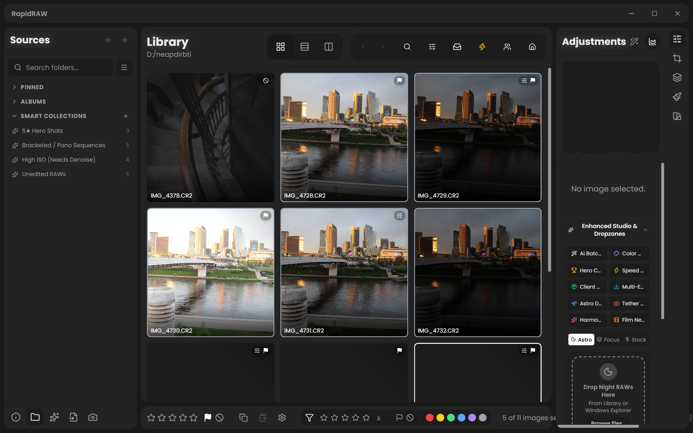
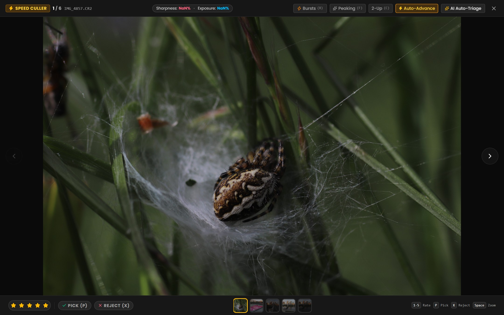
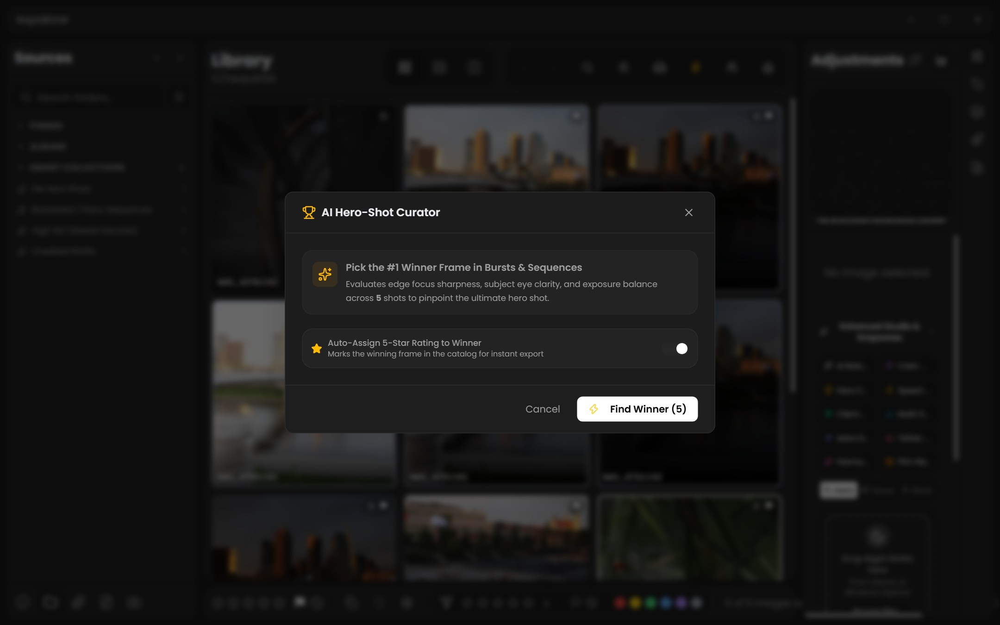

# 01. Library, Catalog & AI Culling

[← Back to Overview](../README.md) · [Next: RAW Editor & Color Science →](02-raw-editor-color-science.md)

---

## 1. Library Grid, Sources, Albums & Smart Collections

`CORE` · `NEW in v1.7.1.3`

*Library view showing the Sources sidebar with SQLite Smart Collections, Quick Filter bar, and high-res Canon `.CR2` RAW grid.*

### What it does
- **Core Library (`CORE`)**: Browse local folders, pin favorite directories, organize virtual **Albums** & **Album Groups**, filter by star ratings (`≥`, `=`, `≤`), Pick/Reject flags, color labels, RAW/edited status, and view **Immich** albums.
- **SQLite WAL Catalog & Smart Collections (`NEW in v1.7.1.3`)**: RapidRAW now indexes folders into a fast, concurrent **SQLite WAL** catalog (`catalog_db.rs`) with built-in and custom **Smart Collections** (e.g., *5★ Hero Shots*, *Bracketed / Pano Sequences*, *High ISO*, *Unedited RAWs*).
- **Auto-Paused CLIP Semantic Search (`NEW in v1.7.1.3`)**: Search your library using natural-language descriptions; background indexing automatically pauses whenever you enter active editing or foreground work so your GPU and CPU stay responsive.
- **Continue Session Restore (`NEW in v1.7.1.3`)**: Reopen RapidRAW and jump right back to your last active folder, selection, and editing context.

> **Why it matters to you:** Large shoots with thousands of RAW files open and filter instantaneously, Smart Collections surface your best or unedited frames automatically, and background AI tagging never stutters your editing workflow.

---

## 2. Speed Culler with MediaPipe EAR Eye Detection

`NEW in v1.7.1.3`

*Speed Culler evaluating `IMG_4857.CR2` with instant Pick (`P`), Reject (`X`), Burst grouping (`B`), Focus Peaking (`F`), 2-Up (`C`), and AI Auto-Triage.*

### What it does
- Full-screen, keyboard-driven culling workflow (`1–5` ratings, `P` Pick, `X` Reject, `Space` Zoom, `Auto-Advance`).
- **MediaPipe Eye Aspect Ratio (EAR) & Sharpness Scoring**: Automatically detects closed eyes/blinks, measures edge sharpness, and powers **AI Auto-Triage** to flag keepers and rejects across burst sequences.
- **Green CFA Focus Peaking (`F`) & 2-Up Compare (`C`)**: Inspect focus directly on raw sensor green-channel detail or compare two frames side-by-side.

> **Why it matters to you:** Cut post-shoot culling time by 70%+—blinked portraits and soft frames are spotted automatically while you fly through keepers with single-keystroke shortcuts.

---

## 3. AI Hero-Shot Curator

`NEW in v1.7.1.3`

*AI Hero-Shot Curator scanning burst sequences to pick the #1 winner frame and optionally auto-assign a 5-star rating.*

### What it does
- Evaluates edge focus sharpness, subject eye clarity, and exposure balance across burst groups (`curate_hero_shots`).
- Optionally auto-assigns a **5-star rating** to the winning frame in each sequence for immediate filtering or export.

> **Why it matters to you:** When you shoot 5–10 frames of the same moment, Hero Curator surfaces the single sharpest, best-exposed frame without manual pixel-peeping.
