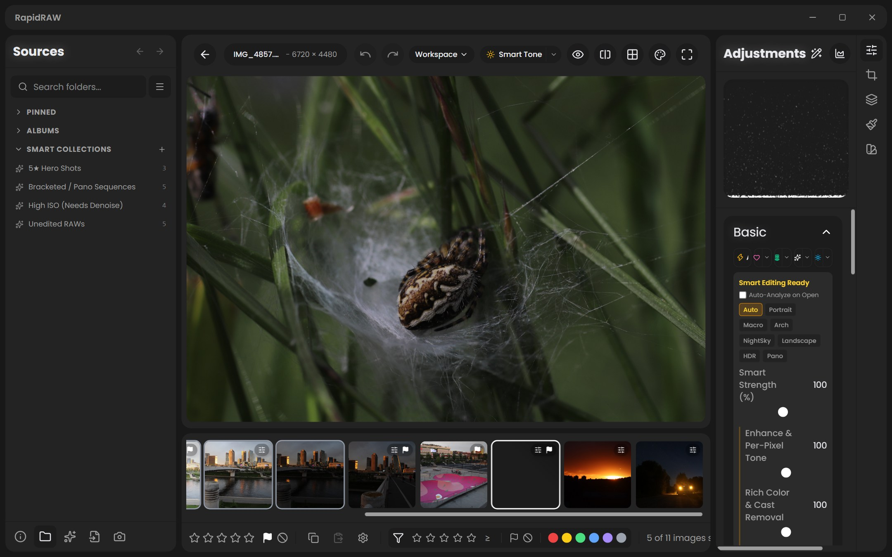
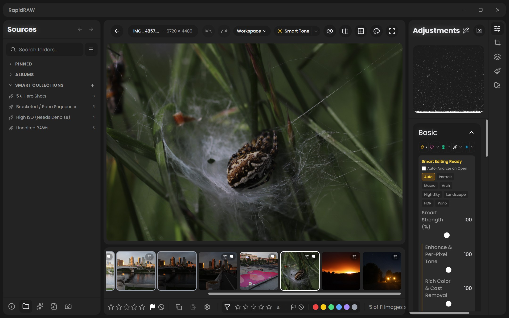
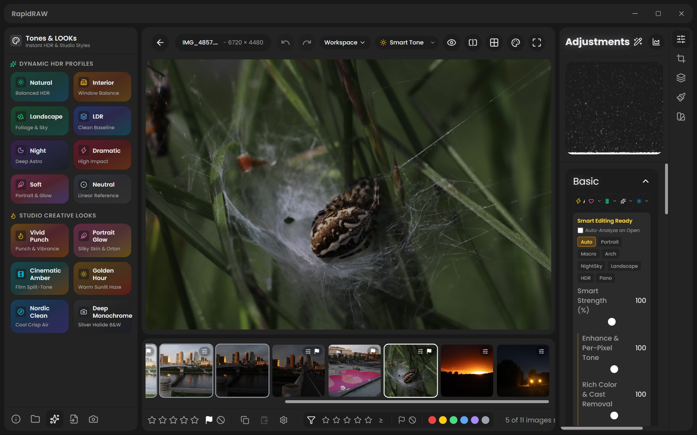
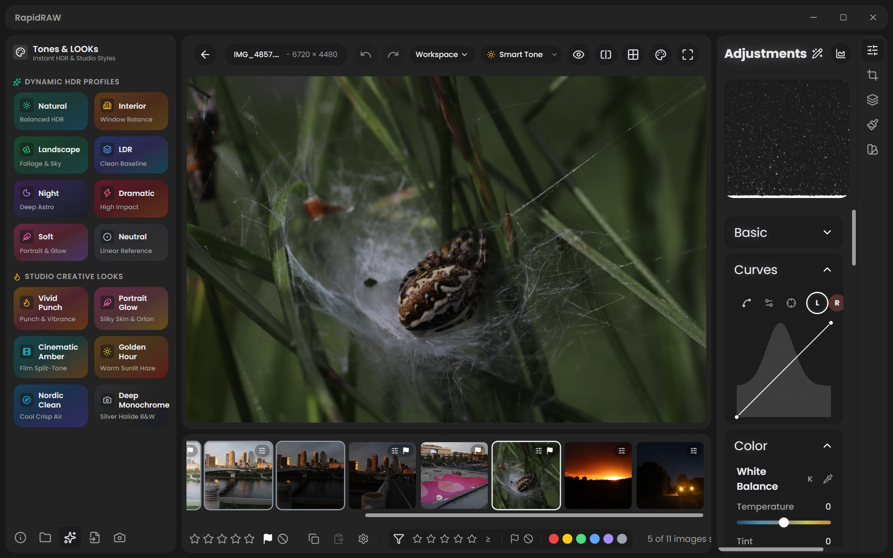
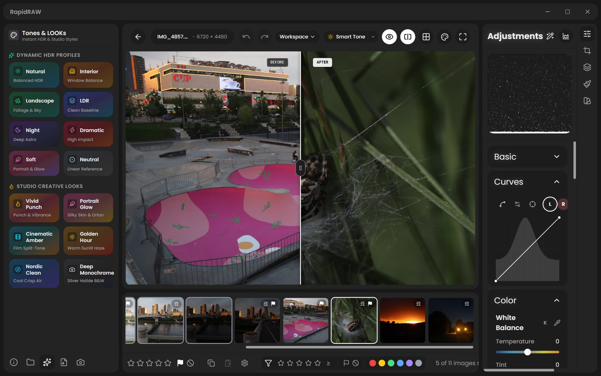

# 02. RAW Editor, Color Science & Pro Scopes

[← Library & Culling](01-library-catalog-culling.md) · [Next: AI Denoise & Portrait Pro →](03-ai-denoise-retouch-portrait.md)

---

## 1. Non-Destructive GPU RAW Editor & Workspace Presets

`CORE` · `UPGRADED in v1.7.1.3`

*Full RAW Editor showing the top Toolbar (Workspace Presets, Smart Tone, Compare modes, HDR toggle), Waveform Scope, Basic Adjustments, and Filmstrip.*

### What it does
- **Core GPU Pipeline (`CORE`)**: Non-destructive `wgpu` rendering in **Rec. 2020** linear working space with **Basic**, **AgX** (darktable-ported highlight roll-off), and **Legacy** tone mappers, **Speed Edit** keyboard+drag adjustment, **Tool Focus** (active-only tools), and **Undo/Redo** across the last 20 edited photos.
- **Workspace Presets (`UPGRADED in v1.7.1.3`)**: Save and switch complete panel layouts, collapsed states, and filmstrip configurations directly from the toolbar **Workspace** menu.
- **Docked Filmstrip & Multi-Monitor Viewer (`CORE`)**: Dock the filmstrip horizontally or as a vertical side-panel grid, or open a second-window viewer for dual-monitor setups.

> **Why it matters to you:** You get an uncluttered, responsive workspace tailored to culling, color grading, or retouching—with instant hardware-accelerated feedback on every slider.

---

## 2. Scene-Aware Smart Auto-Edit & Local Adaptive Priors

`NEW in v1.7.1.3`

*Basic panel with scene-aware Smart Auto-Edit modes (Auto, Portrait, Macro, Arch, NightSky, Landscape, HDR, Pano), Smart Strength sliders, and 1-Click Reject Auto.*

### What it does
- **Scene-Specific Smart Auto-Edit (`NEW in v1.7.1.3`)**: Dedicated scene intelligence for **Portrait / Wedding**, **Macro**, **Night Sky**, **Landscape / Nature**, **Architecture**, **HDR**, and **Panorama**, with independent sliders for *Smart Strength*, *Enhance & Per-Pixel Tone*, and *Rich Color & Cast Removal*.
- **Local Adaptive Priors Engine (`NEW in v1.7.1.3`)**: Learns from your own accepted and rejected auto-edits locally on your machine (`local_priors.rs`)—no cloud required.
- **1-Click Reject Auto (`NEW in v1.7.1.3`)**: Instantly revert a Smart Auto-Edit and teach the local engine your preference.

> **Why it matters to you:** One-click starting points look natural for the specific genre you're shooting and adapt over time to match your personal taste.

---

## 3. Lights Sub-Pipeline, Supercontrast Curve & Reference Presets Ribbon

`NEW in v1.7.1.3`

*Lights Sub-Pipeline, Supercontrast multi-band curve, and Reference Presets Ribbon inside the Adjustments panel.*

### What it does
- **Lights Sub-Pipeline (`LightsSubPipeline.tsx`)**: Fine-grained tonal sculpting for brightness, contrast, details, temperature, and vibrance.
- **Supercontrast Curve (`SupercontrastCurve.tsx`)**: Perceptual multi-band contrast shaping across Shadows, Midtones, and Highlights without crushing blacks or clipping highlights.
- **Reference Presets Ribbon (`ReferencePresetsRibbon.tsx`)**: Quick-access filmic and HDR reference profiles right at the top of your adjustment flow.

> **Why it matters to you:** Achieve rich, three-dimensional tonal separation in seconds without fighting complex multi-point RGB curves.

---

## 4. Tones & Looks Studio Panel (`Panel.Tones`)

`NEW in v1.7.1.3`

*Dedicated Tones & Looks panel featuring Dynamic HDR Profiles and Studio Creative Looks.*

### What it does
- A dedicated, visual-first panel pairing **Dynamic HDR Profiles** (*Natural, Interior, Landscape, LDR, Night, Dramatic, Soft, Neutral*) with **Studio Creative Looks** (*Vivid Punch, Portrait Glow, Cinematic Amber, Golden Hour, Nordic Clean, Deep Monochrome*).

> **Why it matters to you:** Try cohesive, non-destructive creative looks with a single click, then refine any underlying slider in the Adjustments panel.

---

## 5. OKLab Color Grading, Curves & Pro Scopes

`CORE` · `UPGRADED in v1.7.1.3`

*Color grading wheels in OKLab, targeted HSL mixer, parametric/point Curves, and real-time Waveform/Parade/Vectorscope.*

### What it does
- **Core Color & Curves (`CORE`)**: Perceptual **OKLab** 3-way color wheels, expanded HSL Color Mixer with on-image pipette, 3D LUT support, B&W film-response mode, and Curves with fine-adjust mode and inactive channel overlays.
- **Pro Scopes (`UPGRADED in v1.7.1.3`)**: Switch seamlessly between **Luma Waveform (`L`)**, **RGB Overlay (`RGB`)**, **RGB Parade (`P`)**, **Vectorscope (`V`)**, and **Histogram (`H`)** with HDR headroom markers and live hovered-pixel `OKLab` / `RGB` readouts.

> **Why it matters to you:** Broadcast-grade scopes and perceptual OKLab wheels ensure accurate skin tones, balanced shadows/highlights, and predictable prints.

---

## 6. Split Compare Overlay & 4-Way Variant Matrix

`NEW in v1.7.1.3`

*Interactive Split Compare mode dividing Original vs Edited directly on the canvas.*

### What it does
- Compare your active edit against the original RAW (or saved snapshots) using **Vertical Split**, **Horizontal Split**, **Side-by-Side**, or the **4-Way Variant Matrix** (`VariantMatrix4Way.tsx`) to evaluate up to four grading variations simultaneously.

> **Why it matters to you:** Never second-guess whether an edit went too far—compare multiple grades side-by-side at full clarity before exporting.
