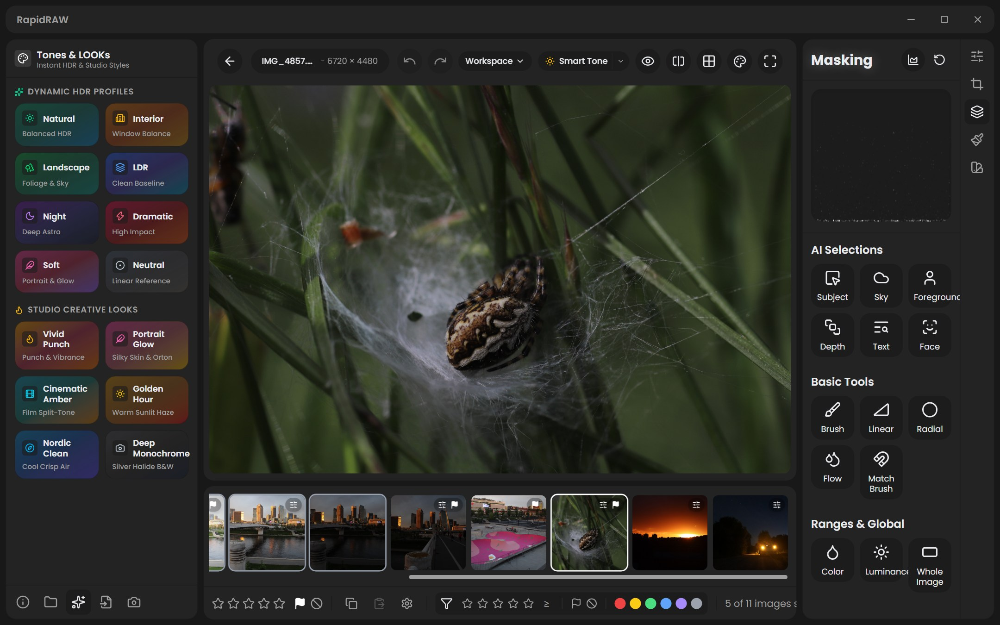
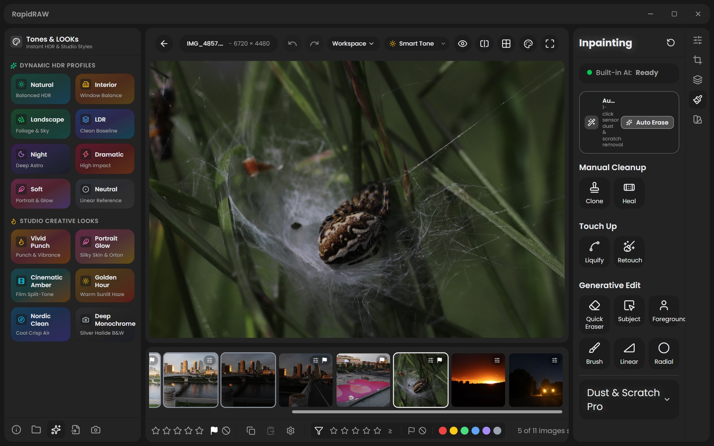
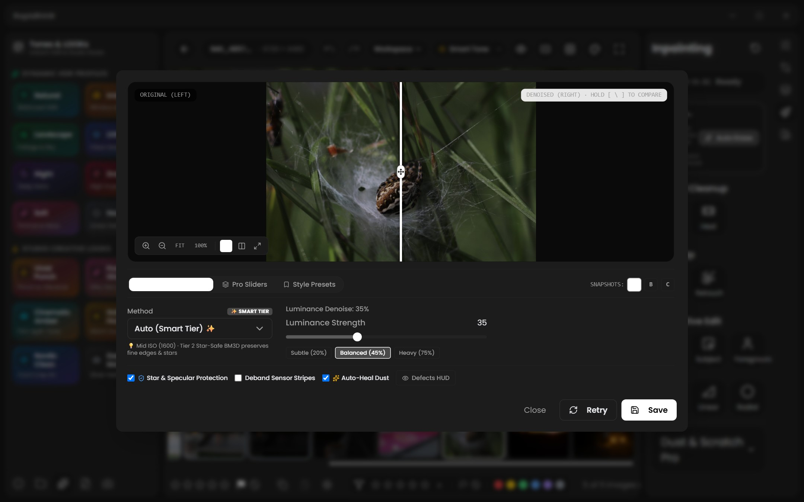
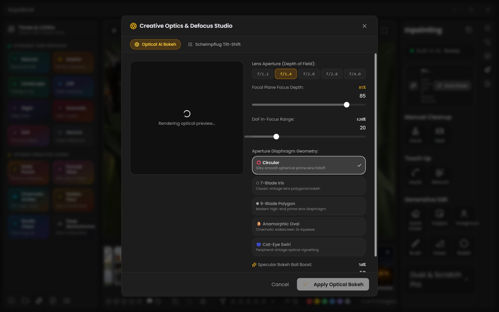
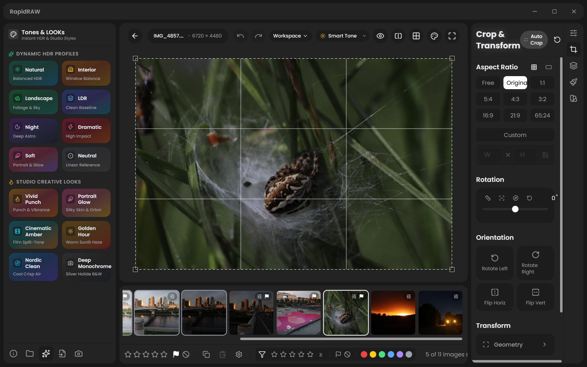

# 03. AI Denoise, Masking, Portrait Pro & Dust Repair

[← RAW Editor & Color Science](02-raw-editor-color-science.md) · [Next: Computational Merges & Astro →](04-computational-merges-astro.md)

---

## 1. AI Masking, Match Brush & Mask Refinement

`CORE` · `UPGRADED in v1.7.1.3`

*Masks panel with AI Subject, Sky, Foreground, Face Parts, Text, Depth Range, Match Brush, and Mask Refinement.*

### What it does
- **Core Masking (`CORE`)**: Local adjustments with **AI Subject**, **AI Sky**, **AI Foreground**, **AI Face** (with individual face parts), **AI Text**, **Depth Range**, **Radial**, **Linear**, **Brush**, and **Match Brush** (adaptive color, tone, and texture matching).
- **Mask Refinement & Portrait Pro (`UPGRADED in v1.7.1.3`)**: Refined edge feathering, grow/shrink controls, and **Portrait Pro** skin-tone matching (`MatchBodyToFaceSkin`) and blemish scanning (`ScanPortraitBlemishes`) for natural, consistent portraits.

> **Why it matters to you:** Isolate skies, subjects, or skin in one click with clean edges—without manual lassoing or halo artifacts.

---

## 2. Interactive Dust & Blemish Spot Editor (`Dust & Scratch Pro`)

`CORE` · `NEW in v1.7.1.3`

*Inpainting panel with Clone, Heal, Liquify, Retouch, Generative Edit, and the new Dust & Scratch Pro spot editor.*

### What it does
- **Core Touch-Up (`CORE`)**: Non-destructive **Clone**, **Heal** (automatic source matching), **Liquify**, **Retouch** (frequency separation smoothing), **Quick Eraser**, and **Isophote / Shield** inpainting guides.
- **Dust & Scratch Pro (`NEW in v1.7.1.3`)**: Automatically scans for sensor dust spots and scratches (`AutoRemoveDustAndBlemishes`), displays interactive spot markers on the canvas (`DustSpotsOverlay.tsx`) where you can accept, reject, or re-route large defects to **LaMa AI Inpainting**, and builds a **Shoot Sensor Dust Map** to batch-heal an entire shoot at once.

> **Why it matters to you:** A dirty camera sensor no longer means hours of tedious spotting—scan once, review on-canvas, and batch-clean every photo from that camera body.

---

## 3. AI Denoise Modal (Smart Auto-Tier, Minimap & ROI Lock)

`UPGRADED in v1.7.1.3`

*AI Denoise Modal showing Smart Auto-Tier selection, split before/after loupe, Star & Specular Protection, Deband, and Auto-Heal Dust.*

### What it does
- **Smart Auto-Tier (`NEW in v1.7.1.3`)**: Inspects your image's ISO, noise sigma, and Bayer/X-Trans CFA layout (`analyze_image_noise_profile`) to recommend the optimal denoiser (*BM3D*, *NAFNet*, *X-Trans GAT*).
- **Interactive ROI Lock & Minimap (`NEW in v1.7.1.3`)**: Preview denoise on a fast region-of-interest crop with a split comparison slider before processing the full-resolution RAW.
- **DirectML Stall Guard & Instant Cancel (`NEW in v1.7.1.3`)**: Safe GPU execution on Windows with hardware stall protection and responsive cancellation.

> **Why it matters to you:** Dial in crisp, artifact-free high-ISO noise reduction in seconds without waiting for a full-image render on every slider tweak.

---

## 4. Optical Bokeh Fusion Modal

`NEW in v1.7.1.3`

*Bokeh Fusion Modal simulating optical aperture blur using AI depth maps.*

### What it does
- Uses RapidRAW's AI depth map to render realistic optical lens blur, aperture blade geometry, specular highlight bloom, and smooth subject-to-background falloff (`SimulateOpticalBokeh` / `SimulateTiltShift`).

> **Why it matters to you:** Add creamy shallow-depth-of-field separation to photos shot on narrow-aperture travel or kit lenses.

---

## 5. Crop, Auto-Straighten, Lens Correction & Transform

`CORE` · `UPGRADED in v1.7.1.3`

*Crop & Transform panel with composition overlays, aspect ratios, Auto-Straighten, and Lensfun optical profile controls.*

### What it does
- **Core Crop & Lens (`CORE`)**: Interactive crop & rotation around the frame, composition guides, custom aspect ratios, **Auto-Straighten**, and **Lensfun** distortion/vignetting/CA correction.
- **Upgraded Geometry & Lens Modals (`UPGRADED in v1.7.1.3`)**: Dedicated **Lens Correction** and **Transform** modals (`LensCorrectionModal.tsx`, `TransformModal.tsx`) with GPU-accelerated guided perspective and saliency crop recommendations.

> **Why it matters to you:** Straighten horizons, fix wide-angle keystoning, and match Lensfun optical profiles with zero guesswork.
