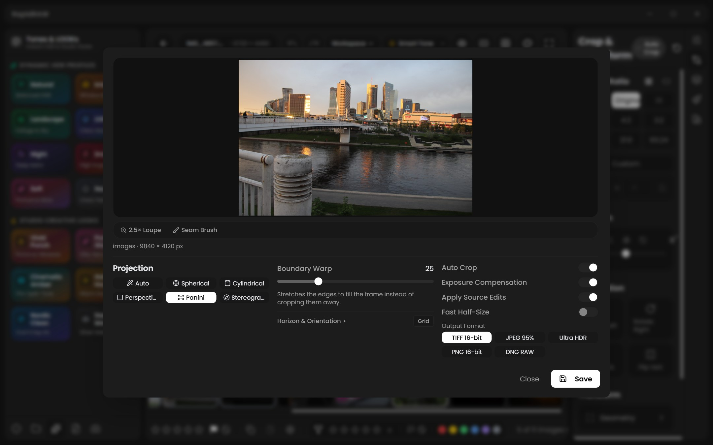
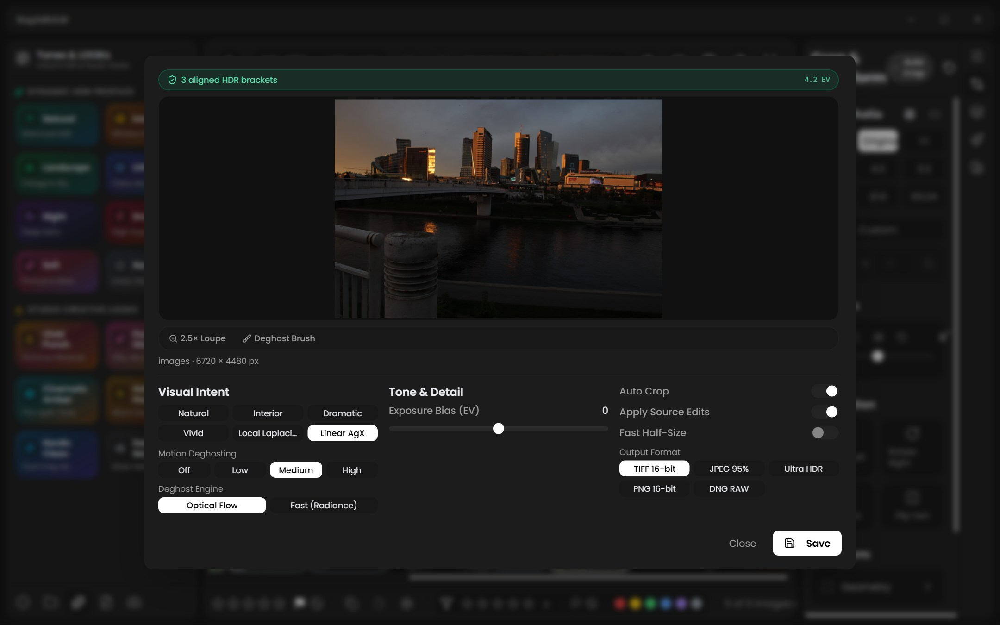
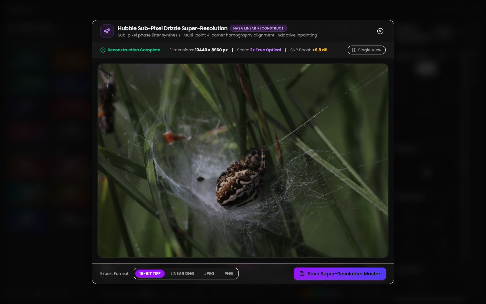
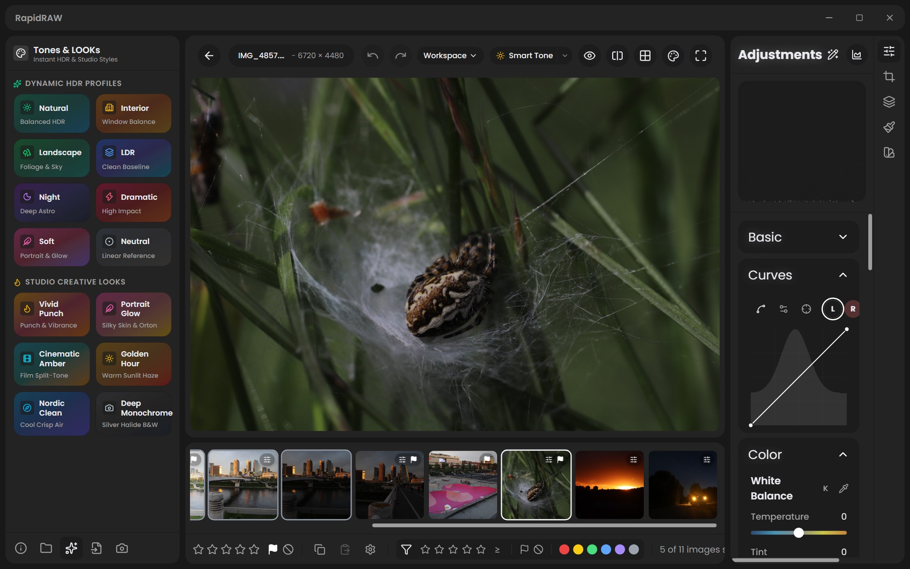
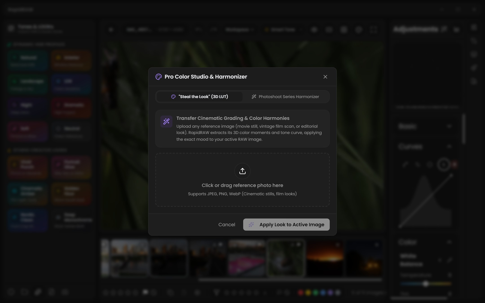
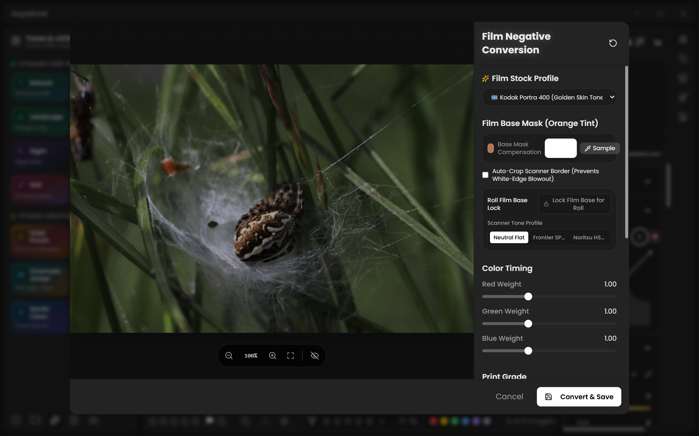

# 04. Computational Merges, Astro & Negative Lab

[← AI Denoise & Portrait Pro](03-ai-denoise-retouch-portrait.md) · [Next: Export, Delivery & Integrations →](05-export-delivery-integrations.md)

---

## 1. Unified Merge Modal — Panorama Stitching

`CORE` · `UPGRADED in v1.7.1.3`

*Unified Merge Modal in Panorama mode with Panini & Stereographic projections, Boundary Warp, Auto Crop, 2.5× Loupe, and 60 FPS Seam Brush.*

### What it does
- **Core Panorama Engine (`CORE`)**: Bundle adjustment, lens distortion & exposure compensation, graph-cut seams, and multi-band GPU blending.
- **Upgrades in `v1.7.1.3` (`UPGRADED in v1.7.1.3`)**:
  - **Panini & Stereographic Projections**: Keep straight architectural verticals in ultra-wide panoramas without extreme edge stretching.
  - **Fast Draft Preview & 60 FPS Seam Brush**: Paint seam overrides smoothly at 60 FPS with a 2.5× Loupe.
  - **DNG RAW & Ultra HDR Outputs**: Save stitched panoramas as 16-bit TIFF, JPEG 95%, PNG, Ultra HDR, or linear **DNG RAW**.

> **Why it matters to you:** Stitch cityscapes and sweeping landscapes with natural geometry, instant seam touch-ups, and full RAW latitude afterward.

---

## 2. Unified Merge Modal — HDR & DepthMap Focus Stacking

`CORE` · `UPGRADED in v1.7.1.3`

*Unified Merge Modal in HDR mode showing bracket validation (`4.2 EV`), Optical Flow Deghosting, Linear AgX tone profile, and Deghost Brush.*

### What it does
- **HDR Bracket Validation & Optical Flow Deghosting (`UPGRADED in v1.7.1.3`)**: Validates bracket alignment and EV spread up front (`validate_hdr_brackets`), then merges with **Optical Flow** or **Fast (Radiance)** deghosting and a **60 FPS Deghost Brush**.
- **DepthMap Focus Stacking (`NEW in v1.7.1.3`)**: Combines macro and product focus brackets using depth-aware fusion for razor-sharp front-to-back detail without focus-breathing halos.

> **Why it matters to you:** Moving trees, water, or people in bracketed shots no longer ruin HDR merges, and macro stacks stay clean from edge to edge.

---

## 3. Hubble Sub-Pixel Drizzle Super-Resolution

`NEW in v1.7.1.3`

*Drizzle Super-Resolution Modal combining 5 frames into a 2× true optical master (`13440 × 8960 px`, `+6.8 dB` SNR boost).*

### What it does
- Combines multiple handheld or tracked RAW frames using **Kappa-Sigma** rejection, sub-pixel phase jitter synthesis, **Bayer CFA** drizzle, and **Auto / Terrestrial / Stars** alignment (`DrizzleModal.tsx`).

> **Why it matters to you:** Gain real optical resolution and cleaner signal-to-noise ratio from burst sequences without hallucinated AI textures.

---

## 4. Unified Dropzones: Night Sky Astro Homography, Focus Stack & Stock Prep

`NEW in v1.7.1.3`

*Expanded Unified Dropzone for Night Sky Astro stacking, Focus Stacking, and Stock Prep right inside the Adjustments sidebar.*

### What it does
- **Night Sky Astro Stacking (`NEW in v1.7.1.3`)**: Multi-frame star alignment via **Astro Homography**, optional **Freeze Ground**, **Light Pollution Gradient Removal**, **G2V Star Color Calibration**, **Star Trails / Comet Decay**, and **Starless Separation** (`astro_starless.rs`).
- **Focus Stack & Stock Prep Dropzones (`NEW in v1.7.1.3`)**: Drag-and-drop RAWs directly from the Library or Windows Explorer into the right-hand sidebar to launch Focus Stacking or Stock Prep immediately.

> **Why it matters to you:** Specialized multi-frame workflows are one drag-and-drop away without hunting through nested menus.

---

## 5. Pro Color Matcher (SOT) & Series Harmonizer

`NEW in v1.7.1.3`

*Color Matcher Modal with "Steal the Look" (3D Sliced Optimal Transport LUT) and Photoshoot Series Harmonizer.*

### What it does
- **"Steal the Look" (`StealColorLook`)**: Extracts 3D color moments and tone curves from any reference still using Sliced Optimal Transport (SOT) and applies them to your active RAW—or exports a `.cube` 3D LUT (`ExportColorMatchAsCubeLut`).
- **Photoshoot Series Harmonizer (`HarmonizePhotoshootSeries`)**: Matches color temperature, contrast, and mood across a multi-shot session to a chosen hero frame.

> **Why it matters to you:** Match a client's reference mood board or unify lighting shifts across an entire wedding or editorial set in seconds.

---

## 6. Film Negative Conversion with Film Base Lock

`CORE` · `UPGRADED in v1.7.1.3`

*Film Negative Conversion Modal featuring Kodak Portra 400 profile, Orange Mask sampling, Auto-Crop Scanner Border, and Roll Film Base Lock.*

### What it does
- **Core Negative Lab (`CORE`)**: Non-destructive inversion of DSLR/mirrorless film scans with film stock profiles, scanner tone curves (*Neutral Flat, Frontier SP, Noritsu HS*), and RGB color timing.
- **Roll Film Base Lock (`UPGRADED in v1.7.1.3`)**: Sample the unexposed orange film border once and lock it across the entire roll (`negative_conversion.rs`), plus auto-crop bright scanner borders to prevent white-edge blowout.

> **Why it matters to you:** Every frame on a 36-exposure roll converts with consistent color balance instead of drifting frame-by-frame.
