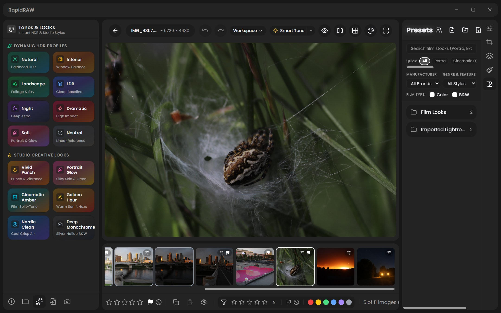
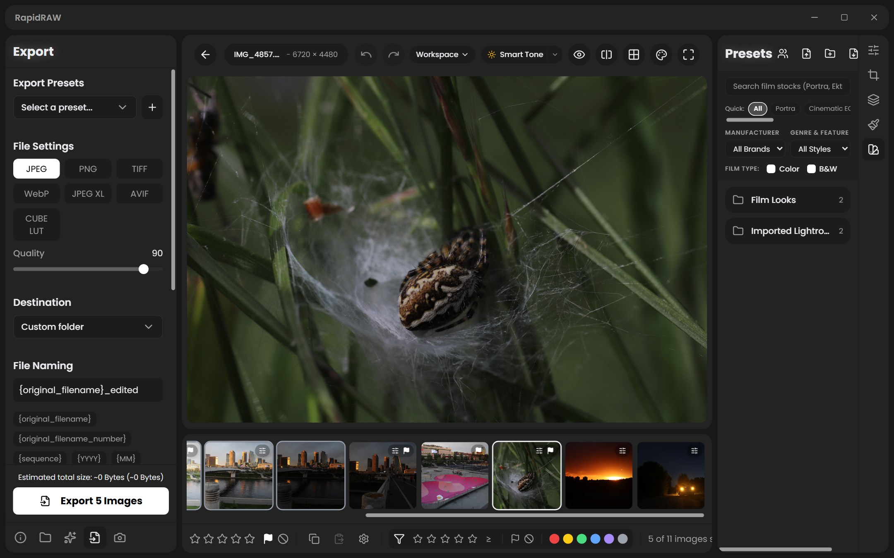
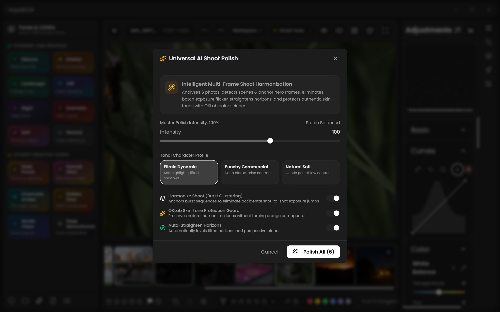
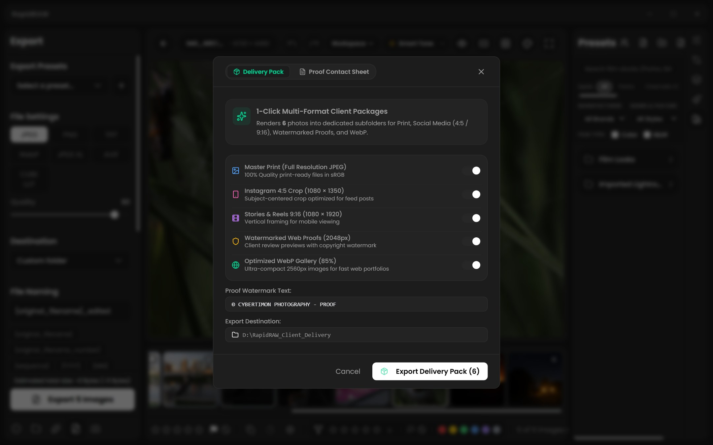
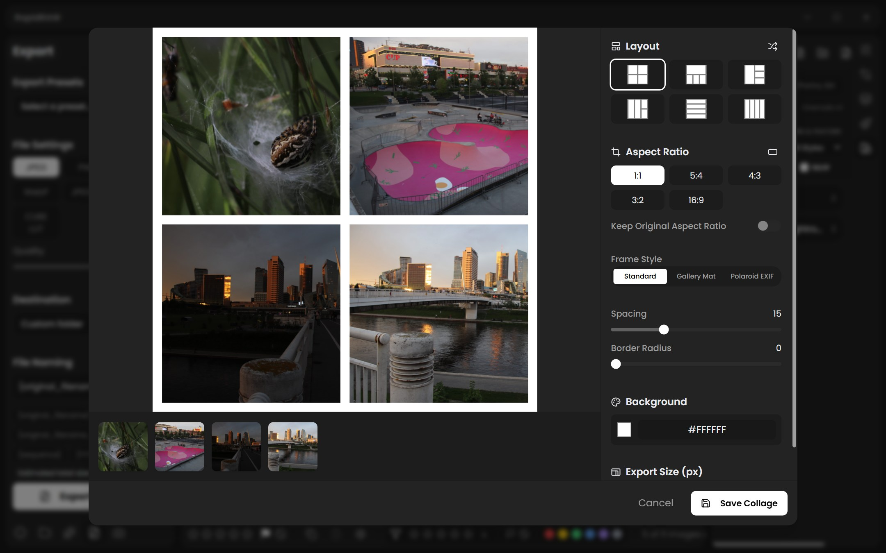
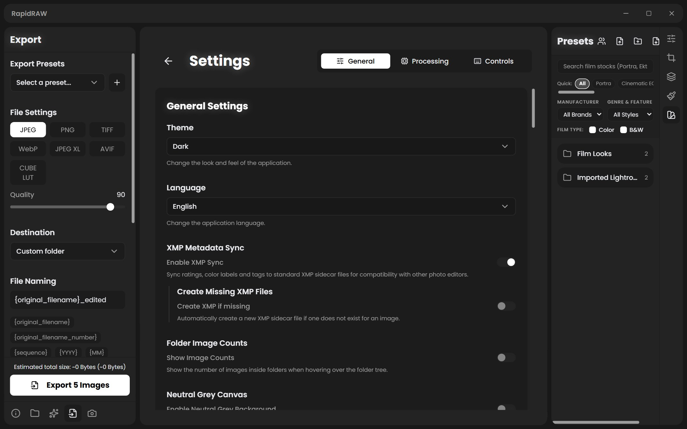

# 05. Export, Stock Prep, Client Delivery & Round-Trip

[← Computational Merges & Astro](04-computational-merges-astro.md) · [Next: Under-the-Hood & Reliability →](06-under-the-hood-v1.7.1.3.md)

---

## 1. Presets Panel with Live Hover Preview & `.lrtemplate` Import

`CORE` · `UPGRADED in v1.7.1.3`

*Presets Panel on the right showing Film Looks, imported Lightroom `.lrtemplate` presets, and manufacturer/style filters.*

### What it does
- **Core Presets (`CORE`)**: Organize style and tool presets in folders, preview looks live on hover, and filter by film stock or style.
- **Lightroom `.lrtemplate` Converter (`NEW in v1.7.1.3`)**: Import legacy Adobe Lightroom `.lrtemplate` preset files directly (`preset_converter.rs`) alongside RapidRAW presets.

> **Why it matters to you:** Bring your existing Lightroom preset library straight into RapidRAW without recreating looks from scratch.

---

## 2. Export Panel, Typography Watermarks & Advanced Batch Export

`CORE` · `UPGRADED in v1.7.1.3`

*Export Panel on the left with JPEG/PNG/TIFF/WebP/JPEG XL/AVIF/CUBE LUT formats, dynamic file naming tokens, and Export Presets.*

### What it does
- **Core Export (`CORE`)**: Export to **JPEG**, **PNG**, **16-bit TIFF**, **WebP**, **JPEG XL (PQ HDR)**, **AVIF**, **Ultra HDR (Gain Map)**, or **CUBE LUT**, with **sRGB / Display P3 / Adobe RGB / ProPhoto RGB / Rec. 2020** ICC profiles, XMP metadata embedding, DPI print settings, borders, and smart conflict skipping.
- **Export Typography Watermarks (`NEW in v1.7.1.3`)**: Render crisp, custom-styled text watermarks onto exports (`typography.rs`, `watermark.rs`).
- **Batch Polish & Advanced Multi-Recipe Export (`NEW in v1.7.1.3`)**: Run AI batch polish across a shoot (`BatchPolishModal.tsx`) or export multiple format/size recipes in one pass (`AdvancedExportModal.tsx`).

*Batch Polish Modal for applying consistent AI tone and clarity polish across selected shoot frames.*

> **Why it matters to you:** Export print-ready 16-bit masters, HDR web photos, and watermarked proofs in one pass with accurate color profiles.

---

## 3. 1-Click Client Delivery Packs & Proof Contact Sheets

`NEW in v1.7.1.3`

*Client Delivery Modal generating Master Print JPEGs, Instagram 4:5 crops, 9:16 Stories, Watermarked Web Proofs, and WebP Galleries in one click.*

### What it does
- Packages a shoot into organized client subfolders—**Master Print (Full Res)**, **Instagram 4:5 (`1080×1350`)**, **Stories & Reels 9:16 (`1080×1920`)**, **Watermarked Web Proofs (`2048px`)**, and **Optimized WebP Gallery**—plus printable **Proof Contact Sheets** (`client_delivery.rs`).

> **Why it matters to you:** Turn a finished edit into a complete client-ready delivery folder in one click instead of running five separate exports.

---

## 4. Collage Maker, Tethering, Stock Prep & Round-Trip Integrations

`CORE` · `UPGRADED in v1.7.1.3`

*Collage Modal with Gallery Mat, Polaroid EXIF captions, multi-aspect layouts, and live preview.*

### What it does
- **Collage Maker (`UPGRADED in v1.7.1.3`)**: Multi-photo grid & editorial layouts with **Standard**, **Gallery Mat**, and **Polaroid EXIF** frames.
- **Tethering Panel (`UPGRADED in v1.7.1.3`)**: Live camera tethering (`TetheringPanel.tsx`) with instant preview and setting control.
- **Stock Prep & Compliance Inspector (`NEW in v1.7.1.3`)**: Automated resolution, noise-floor, highlight-clipping, and trademark/logo compliance checks (`compliance_inspector.rs`, `stock_prep.rs`) before submitting to stock agencies.
- **Edit In, Immich & CLI Launch (`CORE` · `UPGRADED in v1.7.1.3`)**: Round-trip to external editors (*Edit In*), drag-and-drop **Immich** album sync, and direct CLI/file-association launch requests (`launch_request.rs`).

> **Why it matters to you:** RapidRAW fits smoothly into studio tethering, social collage creation, stock photography, and self-hosted Immich workflows.

---

## 5. Settings, Storage & Local Priors Management

`CORE` · `UPGRADED in v1.7.1.3`

*Settings Panel covering Themes, XMP Metadata Sync, Default Per-Camera Adjustments, Lensfun Profiles, and SQLite/AI Storage Management.*

### What it does
- Configure **8 built-in themes**, **UI Scale**, **XMP sidecar sync**, **Per-Camera Default Adjustments**, **Lensfun lens profiles**, **Edit In** external apps, **SQLite Catalog index rebuilds**, **AI cache limits**, and **Local Adaptive Priors** inspection/reset.

> **Why it matters to you:** Full transparency and control over disk caches, camera defaults, and your local AI learning state.
